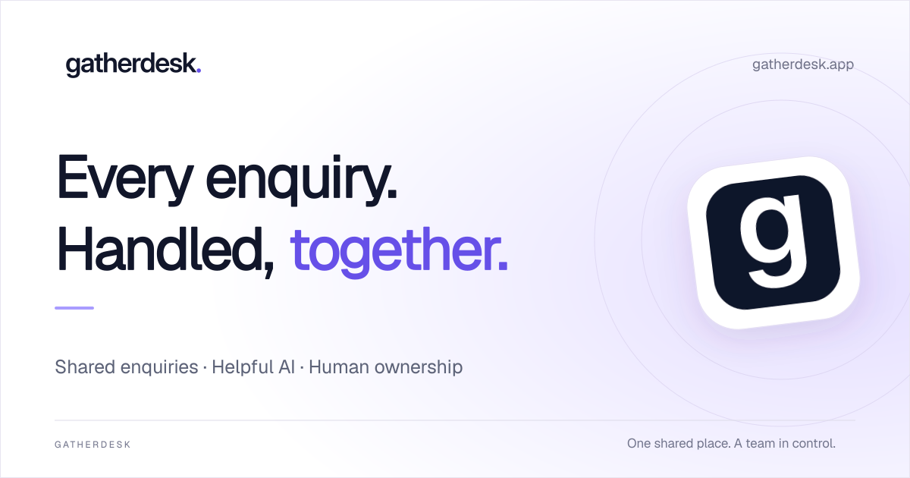
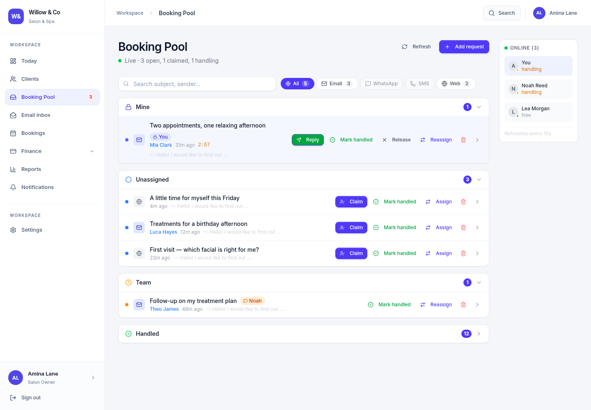
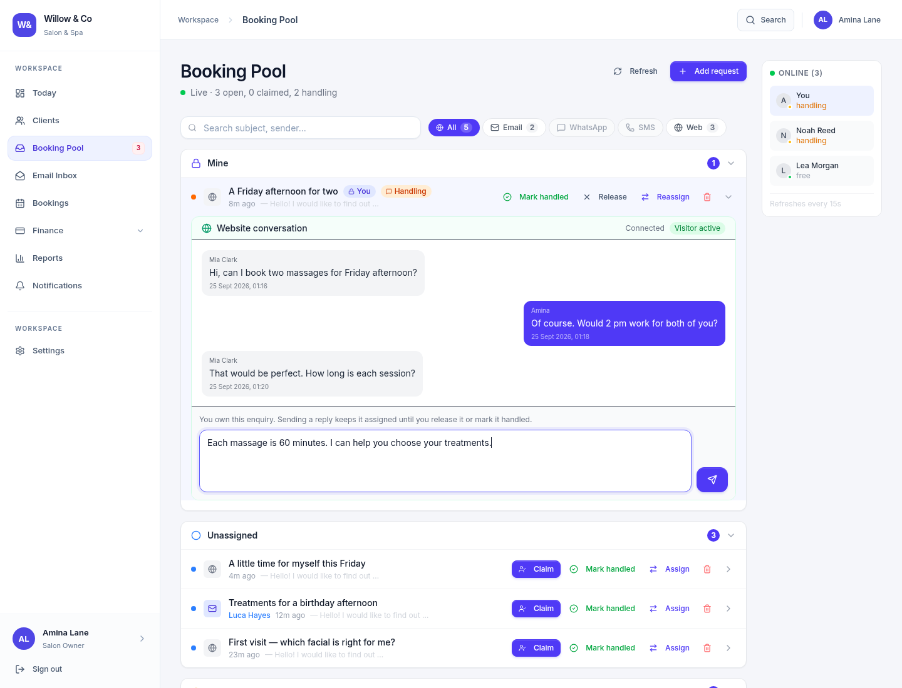
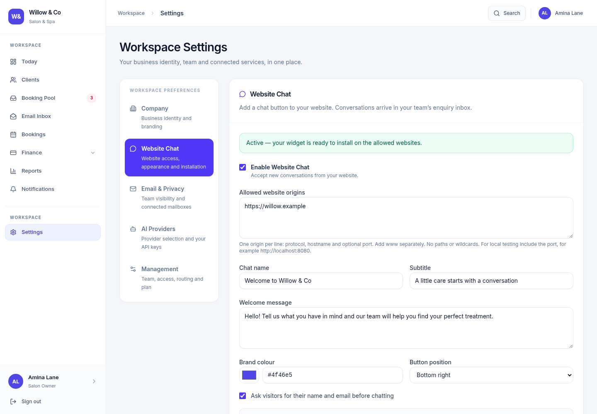

  

**Shared enquiries · Helpful AI · Human ownership**

Run enquiries, work and invoicing for any service business —
in the words your industry actually uses.

 

 

---

## Every message in one shared pool

Email, WhatsApp, SMS and your website chat all arrive in the same place.
Every enquiry gets **one clear owner**, so nothing sits unanswered and two
people never reply to the same customer.

 

---

## Reply from one thread, whatever the channel

Claim an enquiry and it's yours. The whole conversation stays in one place —
your team can see who owns it, and the customer just gets an answer.

 

---

## Connect the channels you already use

Add a chat widget to your site, connect a mailbox, bring your own WhatsApp
Business number. Turn on what you need and leave the rest off.

 

---

## It speaks your trade

Same system, your words — not travel's, and not generic CRM jargon.

| Your business | You see | Your people are |
| :--- | :--- | :--- |
| Salon &amp; spa | Bookings | Clients |
| Dental practice | Treatment Plans | Patients |
| Medical clinic | Care Plans | Patients |
| Estate agency | Deals | Buyers |
| Travel agency | Itineraries | Clients |
| Gym &amp; studio | Programmes | Members |
| Event planning | Events | Clients |
| Trades &amp; home services | Jobs | Customers |
| Online store | Orders | Customers |
| Anything else | Projects | Clients |

 

---

### One shared place. A team in control.

**[Start free →](https://gatherdesk.app/pricing)**

 

[gatherdesk.app](https://gatherdesk.app) · [hello@gatherdesk.app](mailto:hello@gatherdesk.app) · Built by MKweb Communication

